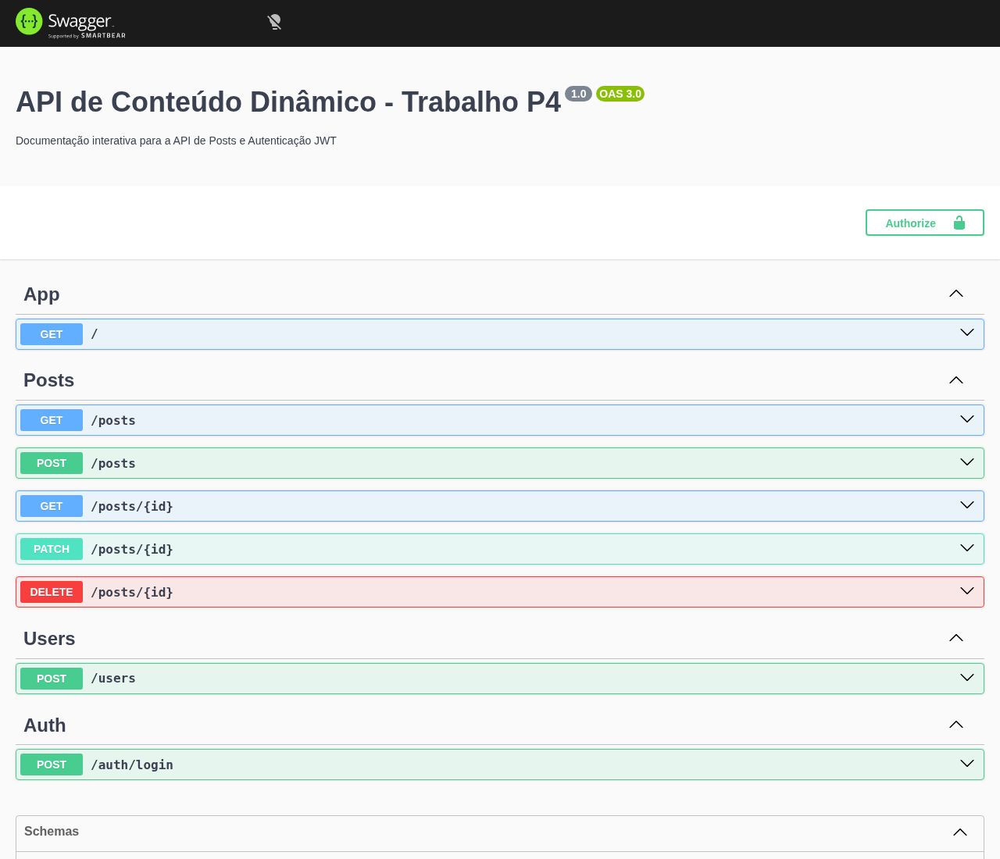
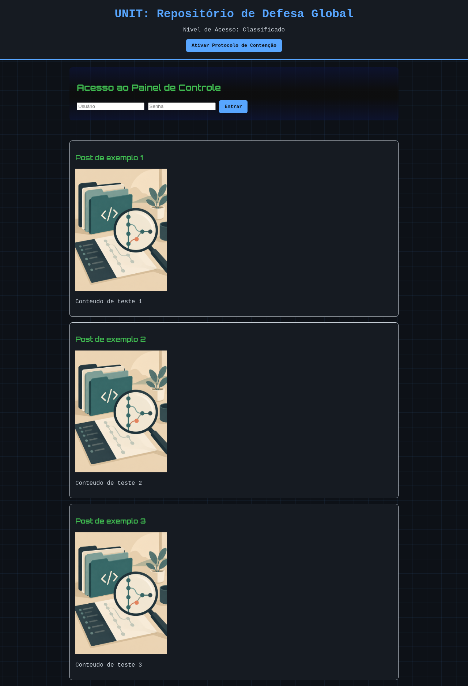

# API de Conteúdo Dinâmico (NestJS + MySQL + JWT)

Trabalho final de Programação IV (UFMT). API REST de posts com login e um front-end em HTML/JS que consome a API.

## O que faz
- Cadastro de usuário (senha com hash bcrypt) e login que devolve um token JWT
- Posts: listar e ver são públicos; criar, editar e apagar exigem token
- Documentação interativa no Swagger em /api

## Tecnologias
NestJS 11, TypeORM, MySQL, JWT, bcrypt, Swagger, Jest.

## Como rodar
1. Tenha Node.js e um MySQL local.
2. Em back-end/, copie o .env de exemplo do README de lá e preencha.
3. npm install, depois npm run start:dev
4. Abra http://localhost:3000/api (Swagger) e front-end/doctorWho.html

## Endpoints
POST /users, POST /auth/login, GET /posts, GET /posts/:id,
POST /posts, PATCH /posts/:id, DELETE /posts/:id (os três últimos pedem token)

## Prints
Prints gerados em ambiente de demonstração: banco SQLite em memória e dados fictícios. Eles não mostram a execução original com MySQL.

